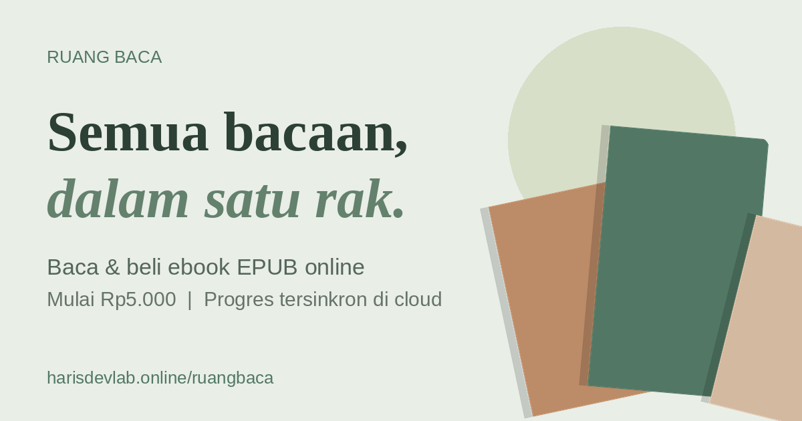

<div align="center">



# Ruang Bacaan

**Perpustakaan digital pribadi untuk membaca dan membeli ebook EPUB berbahasa Indonesia.**
Rak buku di cloud, progres baca tersinkron di semua perangkat, tersedia di web dan Android,
dengan aplikasi admin Windows untuk mengelola pesanan.

[](https://ruangbacaan.my.id)
[](https://ruangbacaan.my.id)
[](#aplikasi-admin-windows)

[](https://github.com/harisratnopambudi/ruangbaca/actions/workflows/deploy.yml)
[](https://github.com/harisratnopambudi/ruangbaca/actions/workflows/android.yml)
[](https://github.com/harisratnopambudi/ruangbaca/actions/workflows/windows-admin.yml)


[Buka Situs](https://ruangbacaan.my.id) · [Unduh Aplikasi Android](https://ruangbacaan.my.id) · [Lapor Masalah](https://github.com/harisratnopambudi/ruangbaca/issues)

</div>

---

## Daftar Isi

- [Fitur](#fitur)
- [Teknologi](#teknologi)
- [Struktur Proyek](#struktur-proyek)
- [Menjalankan di Komputer](#menjalankan-di-komputer)
- [Menyiapkan Supabase](#menyiapkan-supabase)
- [Deploy Situs](#deploy-situs)
- [Pembayaran QRIS Otomatis](#pembayaran-qris-otomatis)
- [Aplikasi Android](#aplikasi-android)
- [Aplikasi Admin Windows](#aplikasi-admin-windows)
- [Keamanan](#keamanan)
- [Rilis Versi Baru](#rilis-versi-baru)

---

## Fitur

### Membaca

| | |
|---|---|
| **Pembaca EPUB** | Mode halaman, gulir, dan dua halaman; efek balik kertas dan swipe |
| **Tampilan nyaman** | Tema terang, sepia, gelap; 10 pilihan huruf; atur ukuran teks, jarak baris, margin, perataan |
| **Bookmark & stabilo** | Tandai halaman dan sorot kutipan dengan enam warna, tersinkron ke cloud |
| **Sinkron antarperangkat** | Lanjutkan bacaan dari posisi terakhir di HP, tablet, atau laptop |
| **Layar tetap menyala** | Layar tidak mati sendiri selama membaca |

### Rak & Katalog

| | |
|---|---|
| **Rak buku pribadi** | Sampul otomatis, cari, urutkan, dan atur urutan dengan seret dan lepas |
| **Katalog ebook** | Harga mulai Rp5.000, paket hemat 3 dan 10 ebook |
| **Pembayaran QRIS otomatis** | QRIS dinamis dengan nominal unik per pesanan; pembayaran terdeteksi otomatis dan buku langsung masuk rak dalam hitungan detik |
| **Konfirmasi manual** | Cadangan jika pembayaran tidak terdeteksi: pembeli mengunggah bukti bayar, admin memverifikasi |
| **Unggah EPUB sendiri** | Terbuka setelah pembelian pertama, mendukung banyak file sekaligus |

### Admin

| | |
|---|---|
| **Kelola pesanan** | Pesanan masuk secara realtime, lihat bukti bayar, terima atau tolak. Pesanan yang lunas otomatis tidak perlu ditangani |
| **Kelola akses** | Beri atau cabut akses buku per email |
| **Buku contoh** | Tandai buku sebagai contoh gratis untuk pengguna baru |
| **Aplikasi admin Windows** | Popup pesanan baru di pojok layar, suara notifikasi, angka di ikon tray |

---

## Teknologi

| Lapisan | Teknologi |
|---|---|
| Antarmuka | React 18, Vite 6, Lucide Icons |
| Pembaca EPUB | epub.js (dimuat terpisah saat dibutuhkan) |
| Backend | Supabase: Auth, PostgreSQL dengan Row Level Security, Storage, Realtime |
| Aplikasi Android | Capacitor 8 |
| Aplikasi admin Windows | Tauri 2 (Rust + WebView2), installer NSIS |
| Hosting & CI/CD | GitHub Pages, GitHub Actions |

---

## Struktur Proyek

```text
ruangbaca/
├── .github/workflows/
│   ├── deploy.yml            # Deploy situs ke GitHub Pages setiap push ke main
│   ├── android.yml           # Build APK Android yang sudah ditandatangani
│   └── windows-admin.yml     # Build installer aplikasi admin Windows
├── admin-desktop/            # Aplikasi admin Windows (Tauri), proyek terpisah
│   ├── src/                  # Antarmuka React: pesanan, popup, suara
│   └── src-tauri/            # Sisi Windows: tray, popup, mulai otomatis
├── assets/                   # Sumber ikon & splash screen aplikasi Android
├── public/                   # File statis: CNAME, sitemap, robots, QRIS, og-image
├── src/
│   ├── main.jsx              # Seluruh aplikasi React
│   └── styles.css
├── supabase/
│   ├── schema.sql            # Tabel dasar, RLS, dan bucket Storage
│   ├── security_hardening.sql# Lapisan keamanan tambahan (jalankan setelah schema)
│   ├── qris_auto.sql         # Pembayaran QRIS otomatis: nominal unik & pencocokan notifikasi
│   ├── qris_fix_1.sql        # Fungsi qris_attach (dipanggil setelah create_order)
│   └── qris_fix_2.sql        # Penyesuaian dengan trigger pengaman trg_guard_orders
├── capacitor.config.json     # Konfigurasi aplikasi Android
├── index.html                # SEO, Open Graph, CSP
└── vite.config.js
```

---

## Menjalankan di Komputer

**Kebutuhan:** Node.js 22 atau lebih baru.

```bash
git clone https://github.com/harisratnopambudi/ruangbaca.git
cd ruangbaca
npm install
```

Buat file `.env` di root proyek:

```env
VITE_SUPABASE_URL=https://PROJECT_ID.supabase.co
VITE_SUPABASE_ANON_KEY=KUNCI_PUBLISHABLE_ATAU_ANON
```

Lalu jalankan:

```bash
npm run dev       # server pengembangan di http://localhost:5173
npm run build     # build produksi ke folder dist/
npm run preview   # pratinjau hasil build
```

> [!WARNING]
> Jangan pernah memasukkan `service_role` key ke `.env` atau kode frontend. Gunakan hanya anon/publishable key.

---

## Menyiapkan Supabase

1. Buat proyek baru di [supabase.com](https://supabase.com).
2. Buka **SQL Editor**, jalankan `supabase/schema.sql`.
3. Jalankan `supabase/security_hardening.sql`. Ganti dulu email admin di bagian atas file.
4. Buka **Authentication → Sign In / Providers → Email**, aktifkan **Confirm email** dan **Secure email change**, lalu atur panjang kata sandi minimal 8 karakter.
5. Buka **Authentication → URL Configuration**:
   - Site URL: `https://ruangbacaan.my.id`
   - Redirect URLs: `https://ruangbacaan.my.id/**`
6. Untuk pembayaran otomatis, jalankan berurutan `qris_auto.sql`, `qris_fix_1.sql`, lalu `qris_fix_2.sql`. Lanjutkan ke [Pembayaran QRIS Otomatis](#pembayaran-qris-otomatis).

> [!IMPORTANT]
> Akses buku diberikan berdasarkan email, jadi **Confirm email wajib aktif**. Tanpa itu, orang lain bisa mendaftar dengan email pembeli.

---

## Deploy Situs

Situs otomatis ter-deploy ke GitHub Pages setiap ada push ke branch `main` melalui `deploy.yml`.

Isi **Settings → Secrets and variables → Actions → Variables**:

| Variable | Isi |
|---|---|
| `VITE_SUPABASE_URL` | URL proyek Supabase |
| `VITE_SUPABASE_ANON_KEY` | Anon/publishable key |
| `VITE_ADMIN_WHATSAPP` | Nomor WhatsApp admin (opsional) |

Domain kustom diatur lewat `public/CNAME`.

---

## Pembayaran QRIS Otomatis

Pembayaran terverifikasi tanpa payment gateway. Setiap pesanan mendapat **nominal unik** (harga + kode Rp1–Rp199), lalu notifikasi dana masuk dari aplikasi **Shopee Partner** di HP diteruskan oleh **MacroDroid** ke Supabase dan dicocokkan dengan pesanan.

```text
Pembeli checkout
   → qris_reserve()  memesan kode unik
   → create_order()  mencatat pesanan (total dihitung ulang di server)
   → qris_attach()   status "menunggu pembayaran", nominal unik, batas 30 menit
   → QRIS dinamis tampil di layar (nominal terisi otomatis)
Pembeli membayar
   → Shopee Partner: "Pembayaran sebesar Rp5.075 diterima ..."
   → MacroDroid → POST /rest/v1/rpc/qris_notify
   → nominal cocok → approve_order() → buku masuk rak, halaman pembeli berubah otomatis
```

### Status pesanan

| Status | Arti |
|---|---|
| `awaiting_payment` | Pesanan dibuat, belum dibayar. Tidak muncul di daftar pesanan admin |
| `pending` | Perlu dicek admin: pembeli mengunggah bukti bayar, atau pembayaran terdeteksi tetapi persetujuan otomatis gagal |
| `approved` | Diterima. Kolom `paid_via = 'qris_auto'` jika lunas otomatis |
| `expired` | Tidak dibayar sampai batas waktu (+15 menit toleransi bayar telat) |
| `rejected` | Ditolak admin |

### Pemasangan

1. Jalankan `qris_auto.sql`, `qris_fix_1.sql`, dan `qris_fix_2.sql` di SQL Editor secara berurutan.
2. Isi email akun admin, dipakai untuk menjalankan `approve_order` secara otomatis:
   ```sql
   update public.qris_config set admin_email = 'EMAIL_ADMIN' where id = 1;
   ```
3. Ambil kunci rahasia untuk MacroDroid:
   ```sql
   select secret from public.qris_config;
   ```
4. Di HP penerima notifikasi Shopee Partner, buat makro **MacroDroid**:

   | Bagian | Isi |
   |---|---|
   | Pemicu | Kejadian perangkat → Notifikasi → **Notifikasi Diterima**; aplikasi **Shopee Partner**; isi tulisan **Berisi** `diterima` |
   | Tindakan | Konektifitas → **Permintaan HTTP**, metode **POST** |
   | URL | `https://PROJECT_ID.supabase.co/rest/v1/rpc/qris_notify` |
   | Tipe konten | `application/json` |
   | Badan konten | `{"p_secret":"KUNCI_RAHASIA","p_title":"[notification_title]","p_text":"[notification]"}` |
   | Header `apikey` | anon key |
   | Header `Authorization` | `Bearer ` + anon key |

5. Atur baterai MacroDroid dan Shopee Partner menjadi **Tidak dibatasi** agar tidak dimatikan sistem.

> [!CAUTION]
> Kunci rahasia `qris_config.secret` hanya boleh ada di MacroDroid. Siapa pun yang mengetahuinya bisa mengirim notifikasi palsu. Jangan commit ke repo. Jika bocor, ganti dengan `update public.qris_config set secret = '...';` lalu perbarui MacroDroid.

### Pengaturan

Tersimpan di tabel `qris_config`:

| Kolom | Default | Arti |
|---|---|---|
| `timeout_minutes` | 30 | Batas waktu pembeli membayar |
| `grace_minutes` | 15 | Toleransi pembayaran yang telat |
| `max_code` | 199 | Kode unik acak Rp1 sampai nilai ini |

### Pemantauan

```sql
select created_at, amount, status, order_code, note
from qris_payments order by created_at desc limit 20;
```

| Status log | Arti |
|---|---|
| `approved` | Cocok dan pesanan diterima otomatis |
| `unmatched` | Nominal mirip pesanan tetapi tidak persis (misalnya dibulatkan). Cek manual |
| `error` | Cocok, tetapi persetujuan otomatis gagal; pesanan masuk ke daftar admin dengan catatan |
| `ignored` | Bukan pembayaran Ruang Bacaan (pemasukan lain lewat QRIS yang sama) |

Jika HP penerima mati atau offline, pembayaran tidak terdeteksi otomatis. Pembeli tetap bisa menekan **"Sudah bayar tapi belum terdeteksi?"** untuk mengirim bukti bayar ke admin.

---

## Aplikasi Android

Aplikasi Android dibangun dengan Capacitor dari kode yang sama dengan situs, lalu di-build dan ditandatangani otomatis oleh GitHub Actions. Android Studio tidak diperlukan.

**Fitur khusus aplikasi:** tombol Back Android, unduh EPUB lewat menu Bagikan, layar tetap menyala dengan plugin native, ikon dan splash screen sendiri.

### Secrets yang dibutuhkan

Isi di **Settings → Secrets and variables → Actions → Secrets**:

| Secret | Isi |
|---|---|
| `KEYSTORE_BASE64` | File keystore `.jks` dalam bentuk base64 |
| `KEYSTORE_PASSWORD` | Kata sandi keystore |
| `KEY_ALIAS` | Alias kunci |
| `KEY_PASSWORD` | Kata sandi kunci |

> [!CAUTION]
> Simpan cadangan file keystore di tempat aman dan **jangan pernah commit ke repo**. Jika kunci hilang, aplikasi tidak bisa diperbarui tanpa pengguna menghapus versi lama.

### Membuat APK

**Rilis resmi (yang diunduh pengguna):** push tag versi, misalnya `git tag v2.1.2 && git push origin v2.1.2`. Workflow akan membangun APK lalu menerbitkannya di halaman **Releases**. Tombol unduh di situs selalu mengarah ke `releases/latest/download/RuangBacaan.apk`, jadi otomatis memakai rilis terbaru. Nomor versi aplikasi diambil dari nama tag.

**Build uji coba:** buka tab **Actions → Build APK Android → Run workflow**, lalu unduh **RuangBacaan-apk** dari bagian **Artifacts**. Build ini tidak diterbitkan ke Releases, dan nomor versinya diambil dari `version` di `package.json`.

> [!NOTE]
> Satu tag hanya bisa dipakai sekali. Jangan membuat rilis manual dengan tag yang sama sebelum workflow selesai, karena langkah penerbitan akan gagal jika rilisnya sudah ada.

---

## Aplikasi Admin Windows

Aplikasi desktop khusus admin untuk menerima dan menolak pesanan, dibangun dengan Tauri dari folder `admin-desktop/`. Installer berukuran kecil dan memakai Supabase yang sama dengan situs.

| Fitur | Keterangan |
|---|---|
| **Popup pesanan baru** | Muncul di pojok kanan bawah, selalu di atas, dan tetap tampil sampai admin menekan **Buka & proses** atau **Nanti**. Tidak merebut fokus dari aplikasi lain |
| **Suara notifikasi** | Berbunyi setiap ada pesanan baru, bisa dimatikan dari ikon lonceng |
| **Angka di tray & taskbar** | Jumlah pesanan menunggu tampil sebagai lencana merah |
| **Kelola pesanan** | Ringkasan harian, lihat bukti bayar, terima atau tolak dengan konfirmasi |
| **Berjalan di latar** | Tombol X menyembunyikan ke tray; opsi mulai otomatis saat Windows menyala |
| **Khusus admin** | Akun non-admin otomatis ditolak; semua aksi tetap dicek di server |

### Membuat installer

1. Buka tab **Actions → Build Admin Windows → Run workflow**.
2. Unduh **RuangBacaanAdmin-Windows** dari bagian **Artifacts**, lalu jalankan file `*-setup.exe`.

Workflow memakai variable `VITE_SUPABASE_URL` dan `VITE_SUPABASE_ANON_KEY` yang sama dengan situs, jadi tidak perlu secret tambahan.

> [!NOTE]
> Installer tidak ditandatangani sertifikat berbayar, sehingga Windows menampilkan *"Windows protected your PC"* saat pertama dipasang. Klik **More info → Run anyway**.

Detail pengembangan ada di [`admin-desktop/README.md`](admin-desktop/README.md).

---

## Keamanan

- **Row Level Security** di semua tabel: pengguna hanya bisa membaca dan mengubah datanya sendiri.
- **Harga dihitung di server**: total pesanan tidak bisa dimanipulasi dari browser.
- **Status pesanan dan akses buku** hanya bisa diubah admin, dicek dengan trigger database. Fungsi QRIS memakai jalur pengecualian `rb.recalc` hanya di dalam fungsi server.
- **Nominal unik dihitung dari total resmi server**, bukan dari angka yang dikirim browser.
- **Endpoint `qris_notify`** dilindungi kunci rahasia; notifikasi duplikat diabaikan berdasarkan nomor transaksi.
- **Storage terkunci**: file EPUB hanya di folder pemilik, bukti bayar hanya bisa dilihat admin dan dihapus setelah diproses.
- **Content Security Policy** di `index.html` membatasi sumber script dan koneksi.
- **Konten EPUB dijalankan tanpa script** (`allowScriptedContent: false`).

Menemukan celah keamanan? Mohon laporkan secara pribadi ke pengelola, jangan lewat issue publik.

---

## Rilis Versi Baru

1. Naikkan `version` di `package.json`, misalnya `2.1.1`.
2. Tambahkan entri baru di **paling atas** `CHANGELOG` di `src/main.jsx`.
3. Naikkan `APP_VERSION` di `src/main.jsx` agar label *update* muncul lagi di tab Aplikasi Android.
4. Push ke `main`, lalu buat dan push tag yang sama dengan versinya, misalnya `git tag v2.1.1 && git push origin v2.1.1`. APK otomatis terbit di **Releases** dan langsung dipakai tombol unduh di situs.

Untuk aplikasi admin Windows, naikkan `version` di `admin-desktop/package.json`, `admin-desktop/src-tauri/Cargo.toml`, dan `admin-desktop/src-tauri/tauri.conf.json`, lalu jalankan **Build Admin Windows**.

---

<div align="center">

Dibuat dan dikelola oleh **[Haris DevLab](https://harisdevlab.online)**

<sub>© 2026 Haris DevLab. Seluruh hak cipta dilindungi.</sub>

</div>
